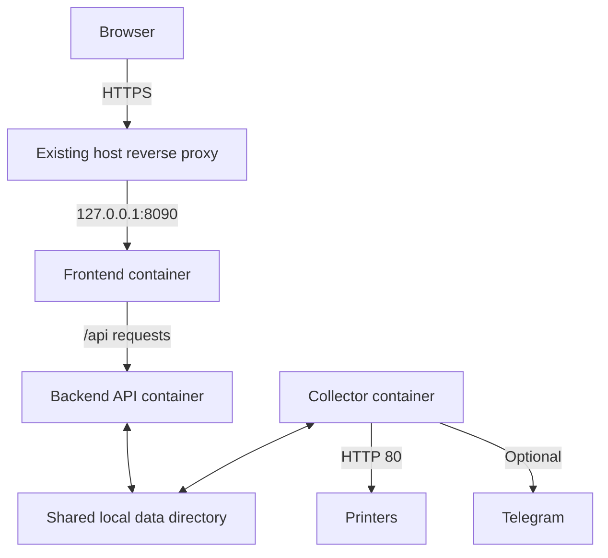

# Printer Dashboard — Milestone 1

Fuji Xerox/ApeosPort monitoring with separate frontend, backend, and collector
services. This milestone keeps existing JSON storage. PostgreSQL is not required.
The printer API parsing, configured printers, thresholds, and polling interval are
preserved. `CONCEPT.md` describes the original prototype and is historical context.

## Architecture



- **Frontend:** Nginx serves existing light (`/`) and dark (`/v1.html`) pages and
  proxies `/api/` to the backend. Both use the same browser origin.
- **Backend:** Python standard-library HTTP API. Reads snapshots, edits stock,
  manages alert dismissals, and queues collection requests. It never polls printers.
- **Collector:** independent Python worker; collects at startup and then waits the
  configured interval after each cycle. It also checks manual requests every second.
- **Storage:** backend and collector share `./data:/app/data`. Frontend has no data
  volume. Atomic file replacement and Linux file locks coordinate JSON writes.
  Use a local Linux filesystem, not NFS/SMB. Run one collector per data directory.

The external host Nginx continues pointing to `127.0.0.1:8090`. That address now
belongs to the frontend. Backend/collector ports are not published. Only the
collector joins the existing `br-printerdash` network for outbound printer traffic.
Frontend/backend share a separate internal Docker network.

## Features retained

- Nine printers in the existing configuration; toner, drums, waste toner, trays,
  faults, counters, driver links, and device information collected from printer APIs.
- Light and dark dashboards with search, filters, and editable spare-parts stock.
- Alert evaluation/dismissal and optional Telegram notifications.
- Append-only consumable history. No PostgreSQL migration, email, login, or new
  reporting features are included in milestone 1.

## Start

Requires Linux, Docker Engine, and Docker Compose v2. Python services use Python
3.11 standard library only; no pip dependencies. Frontend uses Nginx.

```sh
docker compose config -q
docker compose up -d --build
docker compose ps
docker compose logs --tail=100 backend collector frontend
```

Open the existing HTTPS domain, or `http://127.0.0.1:8090` from the server.
Deployment and rollback instructions: [MILESTONE_1.md](MILESTONE_1.md).

## Configuration and polling

Edit `config.json` on the server; do not commit notification credentials. It is
mounted read-only into backend/collector. Restart **collector** after changing
printer addresses, thresholds, or notification settings:

```sh
docker compose restart collector
```

The repository retains its current 60-second interval. To choose five minutes,
set `poll_interval_seconds` to `300` and restart collector. The worker requires a
minimum of 10 seconds. This milestone does not implement different schedules for
individual endpoints, request spacing, or retry backoff.

Printer requests are sequential, with `http_timeout_seconds` applied to each
request. Failed individual endpoints become missing data as in the original
collector. Only a successful `/home/api/about` marks a printer reachable.

Browser data refreshes every 30 seconds; collector health refreshes every 15
seconds. Neither refresh polls printers. **Collect now** queues a request and
returns immediately; existing readings remain visible until the worker completes
and the browser refreshes. Repeated pending requests coalesce into one. A request
accepted while a scheduled poll is running may cause one follow-up cycle.

## Collector status

Both dashboard themes display health, activity, last completed poll, printer
success/failure counts, queue state, and the last collection exception.

- Heartbeat: every 30 seconds, independently of printer HTTP requests.
- `starting`: no worker status file yet.
- `healthy`: recent heartbeat, no cycle exception, and collection progressing.
- `unresponsive`: no heartbeat for more than 90 seconds.
- `degraded`: cycle exception or no completed cycle within the greater of three
  polling intervals and 180 seconds.
- Printer reachability failures are counted separately from worker health.
- Backend/network failure displays an explicit unavailable message in the UI.

A Docker collector healthcheck tests heartbeat freshness, while the UI also checks
collection progress. Docker restart policies restart exited containers, not merely
unhealthy containers. A queued request survives API/worker restarts; an interrupted
poll may be repeated after restart (at-least-once, not exactly-once).

## API

| Method | Path | Purpose |
|---|---|---|
| GET | `/api/health` | Backend liveness, independent of collector |
| GET | `/api/state` | Latest persisted printer snapshot and alerts |
| GET | `/api/collector` | Worker heartbeat, progress, health and queue state |
| POST | `/api/collect` | Queue collection; returns HTTP 202 and request ID |
| GET | `/api/stock` | Read spare-parts stock |
| POST | `/api/stock` | Replace stock with `{ "items": [...] }` |
| POST | `/api/dismiss` | Dismiss alert; form body or query `key` |
| POST | `/api/restore` | Restore alert; omit `key` to restore all |

`GET /api/collect` now returns 405. Update any external scripts to POST. Root/static
URLs are served only by frontend. `/healthz` is the frontend's own liveness check;
use `/api/health` for backend reachability.

## Persistent data

`/opt/printer-dashboard/data/` on the reference server maps to `/app/data`:

| File | Owner/purpose |
|---|---|
| `state.json` | Collector snapshot; backend can update dismissal flags |
| `history.jsonl` | Collector appends consumable history |
| `stock.json` | Backend stores stock |
| `dismissed.json` | Backend/collector coordinate dismissal state |
| `notify_state.json` | Collector notification cooldown state |
| `collector_status.json` | Worker heartbeat and progress |
| `collect_request.json` | Backend queues, collector acknowledges requests |
| `.data.lock`, `.collector.lock` | Local coordination files; do not remove while running |

Existing files remain compatible. Backend reads work without a running collector.
Back up the data directory and server configuration. Stop backend/collector for a
consistent copy across all JSON files. Stock edits are whole-list saves; concurrent
users can overwrite each other's stock changes (unchanged limitation).

## Tests

```sh
python -m unittest discover -s tests -v
```

Integration tests use a local fake printer and temporary storage: API never polls,
worker collection/queue, duplicate-worker protection, API restart isolation,
persistent stock/requests, health transitions, and alert dismissal retention.

## Access

The dashboard still has no authentication. Keep it on the approved internal
network behind the existing HTTPS reverse proxy. Login/roles are a later milestone.
